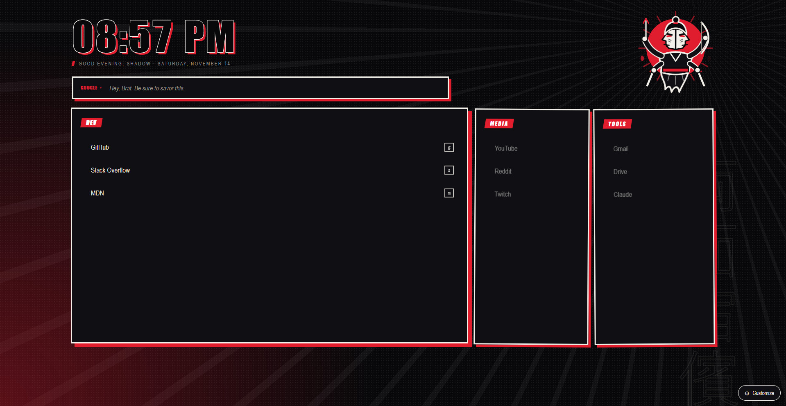
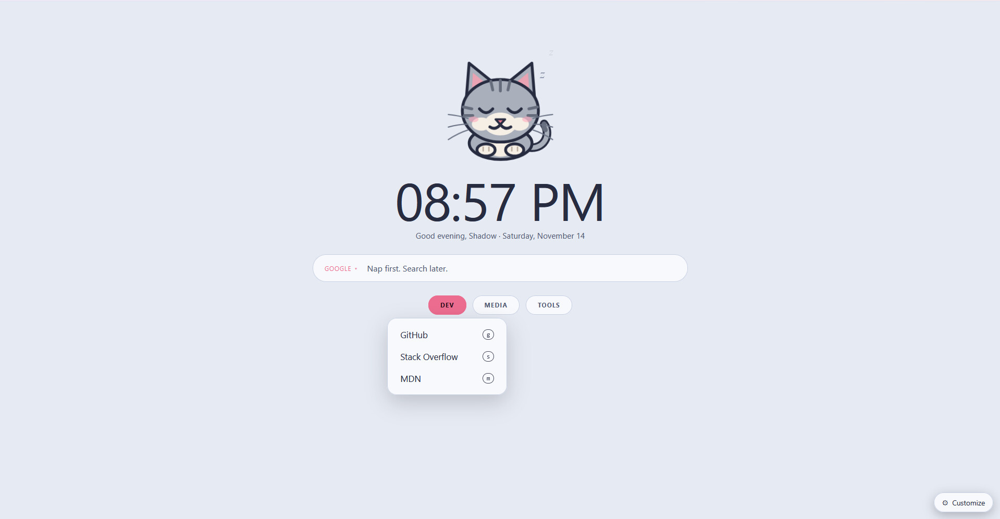
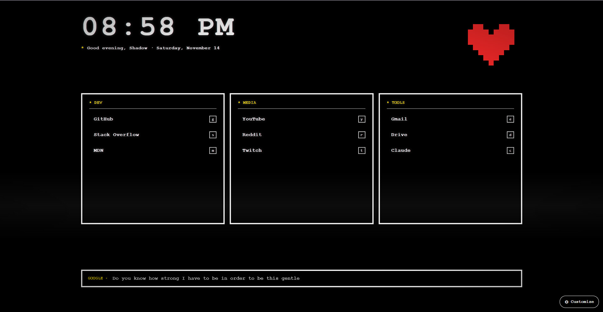
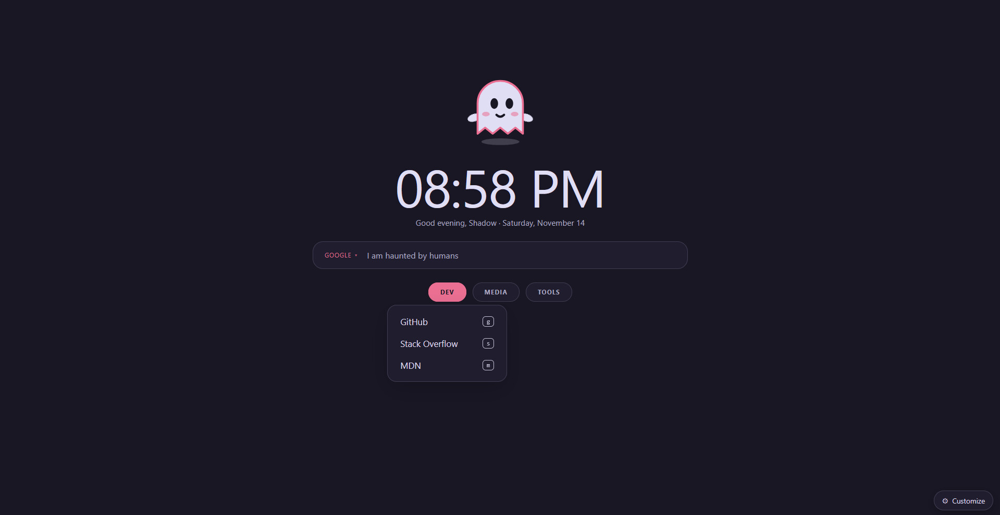
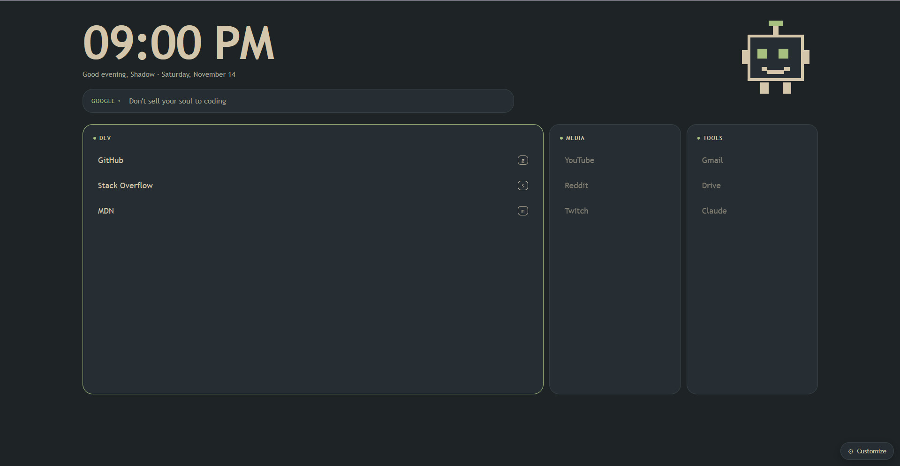
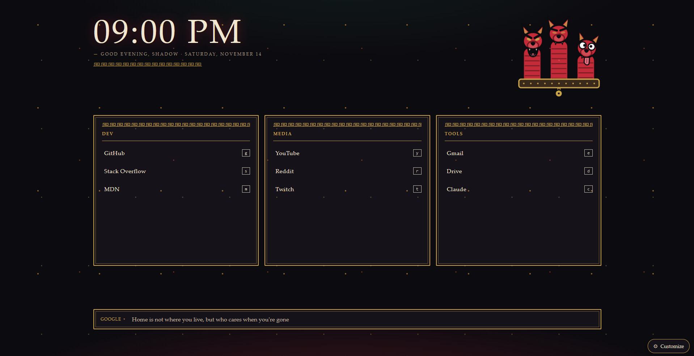
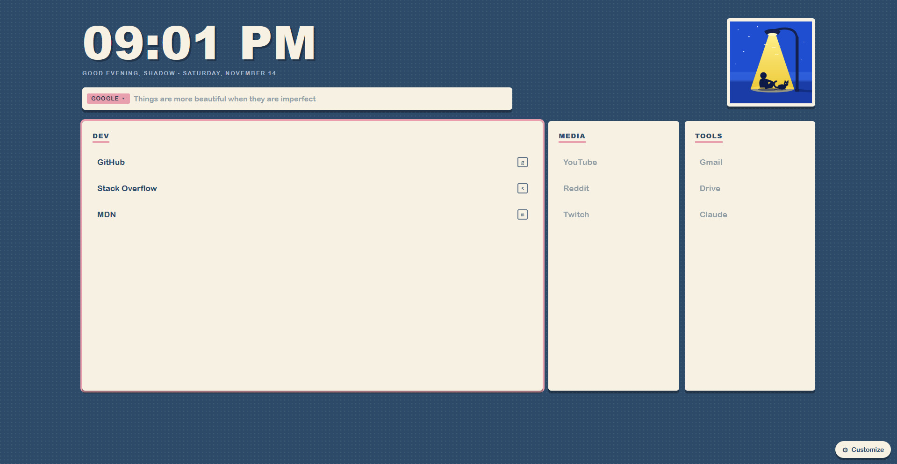
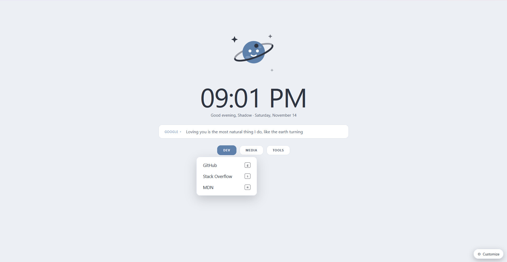
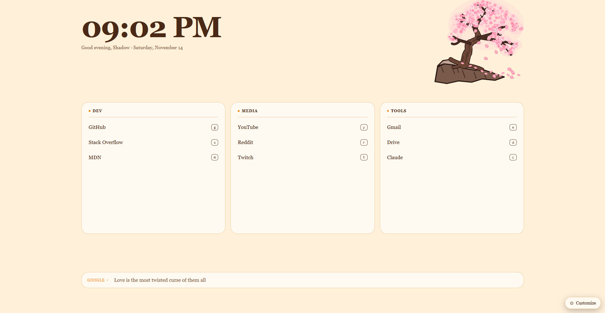

# Tabify - A themed startpage for your new tab.

Here you can find the startpage I made for my browser :)
Nine whole looks, not just colors: each theme has its own layout, box style, animated mascot and search-box line.
You can change everything in the Customize page, add your own links with one-key shortcuts, and use your own image or GIF.

**Live page:** https://lordshadow-afk.github.io/Tabify/

Free to host (plain static files), no accounts, nothing is sent anywhere. Issues and forks are welcome.

## Usage

The quickest way:

1. Install **New Tab Override** for [Chrome](https://chromewebstore.google.com/search/New%20Tab%20Override) or [Firefox](https://addons.mozilla.org/firefox/search/?q=New%20Tab%20Override).
2. Paste this into its text field to set it up as your new tab:

   ```
   https://lordshadow-afk.github.io/Tabify/
   ```

3. Open a new tab and press **Customize** to pick a theme, change colors, art and links.
4. Open **Customize, General, Keep my settings safe**, copy your **personal link** and paste that into New Tab Override instead.
   Clearing site data in Firefox or Chrome wipes what a page saves. The personal link holds your whole setup after the `#`
   (never sent to a server), so everything comes back by itself. For uploaded images use **Download backup**.

## Themes

Click **Customize, Theme** to switch. Every theme can be mixed with any layout and box style.

### Ryōmen
Accordion · Manga ink



Inspired by the legend of the two-faced Ryōmen in the Nihon Shoki, and the dark-fantasy manga mood of *Jujutsu Kaisen*.

### Rigby
Minimal · Soft



Original design.

### Underground
Cards · Retro RPG



Inspired by the look of [Undertale](https://undertale.com) by Toby Fox: black boxes, thick white frames, a heart pointer.

### Rosé Night
Minimal · Soft



Original design.

### Moss Garden
Accordion · Soft



Original design.

### Crimson Styx
Cards · Classical Greek



Inspired by the look of [Hades](https://www.supergiantgames.com/games/hades/) by Supergiant Games and the myth of the three-headed hound.

### Ocean Glass
Accordion · Halftone poster



Inspired by the look of vintage screen-printed character posters.

### Frost Orbit
Minimal · Soft



Original design.

### Tangerine
Cards · Soft



Inspired by the mood of the drama *When Life Gives You Tangerines* (Netflix, 2025): love, joy and sorrow arriving together.

If you made a theme and want to see it here, open an issue and share the JSON.

## What you can customize

| What | Where |
| --- | --- |
| Theme, layout (accordion, minimal, cards), box style (soft, retro, classical, ink, poster) | Customize, Theme |
| 7 colors, corner radius, font, search-box text, CRT flicker | Customize, Theme |
| Mascot art, or your own image or GIF (link or upload up to 30 MB), background with overlay | Customize, Art & BG |
| Cards and links with one-key shortcuts (up to 40 cards, 60 links each, 500 in total) | Customize, Links |
| Search engine (also by clicking its name on the search bar), clock, greeting | Customize, General |
| Copy or paste a theme as JSON, backup file | Customize, Theme and General |

Links are plain text. A blank line starts a new card, the first line is the card name:

```
Dev
GitHub | https://github.com | g
Stack Overflow | https://stackoverflow.com | s

Media
YouTube | https://youtube.com | y
```

A theme is JSON. Only `name` is required; colors are `#rrggbb` and images are `https` addresses. Anything invalid is replaced by a safe default.

```json
{
  "name": "Midnight",
  "layout": "cards",
  "skin": "",
  "placeholder": "Search or type a URL…",
  "radius": 14,
  "colors": { "bg": "#0e1018", "surface": "#171a26", "border": "#262b3d", "text": "#e6e9f5", "muted": "#8a90ab", "accent": "#7aa2f7", "accentText": "#0e1018" },
  "art": { "mode": "mascot", "mascot": "drop", "size": 120 }
}
```

## Local setup

1. Download this repository (Code, Download ZIP).
2. Serve the folder, for example `python3 -m http.server 8080`, and open `http://localhost:8080`.
3. Use that address in New Tab Override.

## Host your own copy

1. Fork this repository (public).
2. In **Settings, Pages** set **Source** to **GitHub Actions**.
3. Run the **Deploy to GitHub Pages** workflow (Actions tab, **Run workflow** on `main`).
4. Your page is at `https://YOUR-NAME.github.io/REPOSITORY-NAME/`.

After changing CSS, raise the `?v=` number on the stylesheet links in `index.html` so browsers fetch the new files.

## Advanced: changing the code

No build step and no dependencies. Node 22+ is only needed for the tests.

```
npm test        # unit tests
npm run serve   # http://localhost:8080
```

Built-in themes live in `js/themes.js`, mascots in `js/avatars/`, and every check on untrusted input in `js/sanitize.js`.
Security notes are in [SECURITY.md](SECURITY.md).

## Sources

- Idea and accordion startpage: [Fluidity](https://github.com/PrettyCoffee/fluidity) and [b-w-kitty](https://github.com/PrettyCoffee/b-w-kitty) by PrettyCoffee. No code copied.
- CRT flicker idea: ["CRT Screen Text Flicker Animation In Pure CSS"](https://codemyui.com/crt-screen-text-flicker-animation-in-pure-css/) on CodeMyUI. Code written from scratch.
- All mascots and art are drawn from scratch for this project. Full references: [CREDITS.md](CREDITS.md).
- Code is MIT licensed ([LICENSE](LICENSE)). Not affiliated with any game, show or publisher it pays homage to.